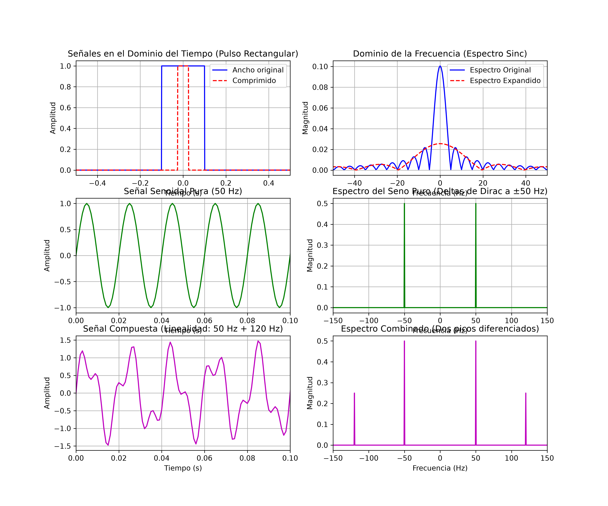

# Simulación y Análisis de Señales con la Transformada de Fourier

Este repositorio contiene la solución práctica para la **Actividad Formativa 2**. Se implementó un script en Python para modelar y analizar señales en los dominios del tiempo y de la frecuencia utilizando la Transformada Rápida de Fourier (FFT).

## 🛠️ Requisitos e Instalación
Para ejecutar este código en tu computadora, necesitas instalar las siguientes librerías desde tu terminal:
```bash
pip3 install numpy matplotlib scipy
```

## 📊 Gráficas Generadas
A continuación se muestran los resultados visuales de la simulación, donde se validan las propiedades de escalamiento (en el pulso rectangular) y linealidad (en la señal compuesta):



## 🎯 Conclusiones del Análisis
1. **Escalamiento:** Al comprimir el pulso rectangular en el tiempo, su espectro Sinc se expandió en frecuencia. Esto demuestra que los eventos más veloces requieren mayor ancho de banda.
2. **Linealidad:** La FFT logró separar perfectamente la señal compuesta de 50 Hz y 120 Hz en dos picos de frecuencia puros y diferenciados.
